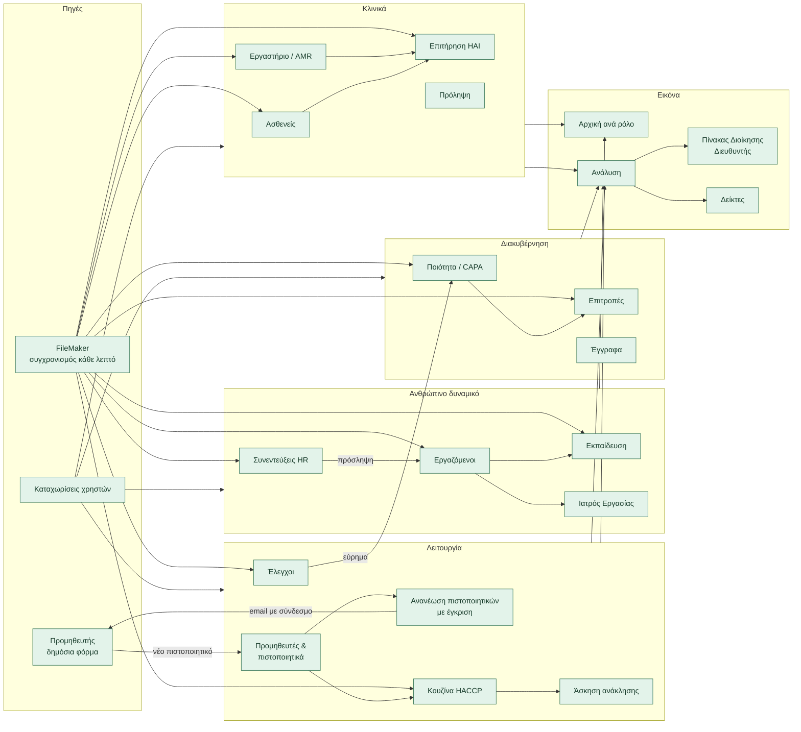
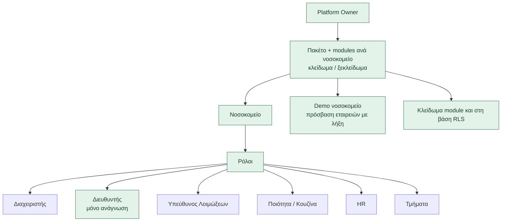
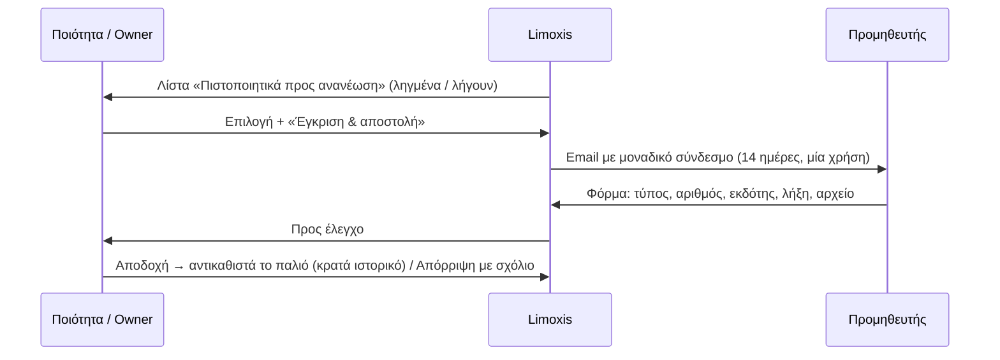

# Ροή πλατφόρμας και πρόοδος υλοποίησης

Ζωντανός χάρτης του Limoxis Observer: ποια ενότητα (module) τροφοδοτεί ποια, ποιος
ρόλος δουλεύει πού, και τι είναι υλοποιημένο, σε εξέλιξη ή προτεινόμενο. Ενημερώνεται
σε κάθε υλοποίηση (άλλαξε την κλάση `done` / `wip` / `next` του κόμβου).

Υπόμνημα: πράσινο = υλοποιημένο · πορτοκαλί = σε εξέλιξη · γκρι διακεκομμένο = προτεινόμενο.

## 1. Modules και ροή δεδομένων

## 2. Πρόσβαση: Platform Owner → νοσοκομείο → ρόλος

## 3. Ροή ανανέωσης πιστοποιητικού προμηθευτή

## 4. Κατάσταση υλοποίησης

| Ενότητα | Κατάσταση | Σημείωση |
|---|---|---|
| Ταχύτητα: ενιαίοι μετρητές αρχικής, καμπανάκι, Έλεγχοι, Επιτήρηση, Ασθενείς, Ανάλυση | Υλοποιημένο | 27 αιτήματα → 1· Ασθενείς 35 αιτήματα → 1 (70 ms) |
| Ρόλος Διευθυντή + Πίνακας Διοίκησης | Υλοποιημένο | φίλτρα, σύγκριση περιόδου, PDF |
| Modules ανά νοσοκομείο (κουζίνα, προμηθευτές, συνεντεύξεις, ανάλυση, διοίκηση) | Υλοποιημένο | στο UI και στη βάση (132 πίνακες)· συγκεντρωτικές αναγνώσεις: μόνο στο UI |
| Άσκηση ανάκλησης κουζίνας | Υλοποιημένο | χρονόμετρο, ιχνηλάτηση, ισοζύγιο, PDF |
| Ανανέωση πιστοποιητικών προμηθευτών | Υλοποιημένο | χρειάζεται SMTP σε παραγωγή· ομαδοποίηση ανά προμηθευτή: προτεινόμενο |
| Συνεντεύξεις HR από FileMaker | Υλοποιημένο | 2 αιτήσεις μεταφέρθηκαν |
| Σύγχρονο login | Υλοποιημένο | |
| Πίνακας οθονών ΕΛ/EN · γεμάτο/άδειο · desktop/tablet | Υλοποιημένο | `npm run screens:matrix` |
| Καθαρισμός διπλών αρχείων FileMaker | Υλοποιημένο | −1,68 GB |
| Μετατροπή σε TypeScript | Προτεινόμενο | σταδιακά ανά φάκελο, νέο session |
